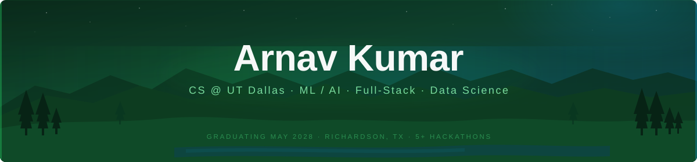

<div align="center">



<br/>

[](https://itsarnav.com)
[](https://www.linkedin.com/in/arnav-kumar2932/)
[](mailto:axk230197@utdallas.edu)

<br/>

### Data Engineering • Software Engineering • Applied AI

</div>

---

## About Me

I'm **Arnav Kumar**, a rising Junior at **UT Dallas**, currently a **Data Engineering Intern at Resilient Inc.** — previously an AI/ML Engineering Intern at Flexon Technologies, where I helped ship an NLP-driven ETL pipeline to production.

My focus is data engineering: pipelines, orchestration, and the agentic systems that keep them healthy. I build things that hold up under real constraints — deterministic safety gates instead of "trust the LLM," bias audits instead of "assume it's fair," measured results instead of assumed ones. Two of the projects below (below in **Featured Projects**) are ones I can walk through in depth, decision by decision, in an interview.

5+ hackathons, 2 wins.

---

## Experience

**Data Engineering Intern — Resilient Inc.** · *Current*

**AI/ML Engineering Intern — Flexon Technologies**
- Built and deployed an NLP-driven ETL pipeline to production, processing documents at **130/minute**, including a full run across 600 resumes.

**Project Manager — IEEE Computational Imagery, UTD**
- Coordinated project planning and cross-functional execution for the chapter's computational imaging initiatives.

**Front-End Developer — Project Management Club (PMC), UTD**
- Migrated the club site from vanilla HTML/CSS to Next.js, improving load speed by **~200ms**, verified with Google PageSpeed Insights.

---

## What I Build

<table>
<tr>
<td width="50%">

### Data Engineering & Governance
- Orchestrated ETL/ELT pipelines (Airflow, Dagster, dbt)
- Streaming ingestion (Kafka/Redpanda, CDC)
- Multi-agent pipeline QA, diagnosis, and remediation
- Governance, lineage, and bias/compliance auditing

</td>
<td width="50%">

### AI / Agentic Systems
- Multi-agent orchestration with LangGraph
- Deterministic safety-checks gating autonomous actions
- Fine-tuning (QLoRA), inference, and ONNX/CUDA deployment
- Computer vision and geospatial ML

</td>
</tr>
<tr>
<td width="50%">

### Reliability & Observability
- Chaos engineering and blast-radius scoring
- Kubernetes-native systems
- Traces, metrics, and logs (OpenTelemetry, Prometheus, Grafana)

</td>
<td width="50%">

### Full-Stack Products
- TypeScript, React, Next.js, NestJS
- REST APIs, databases, and deployment workflows
- Clean, production-style UIs backed by real data models

</td>
</tr>
</table>

---

## Tech Stack

**Languages**
<p>
  
  
  
  
  
  
</p>

**Data Engineering & Orchestration**
<p>
  
  
  
  
  
  
  
  
  
</p>

**AI / Agentic Systems**
<p>
  
  
  
  
  
</p>

**Cloud, DevOps & Full-Stack**
<p>
  
  
  
  
  
  
  
  
  
</p>

---

## Featured Projects

*These are the two I can go deepest on — architecture decisions, bugs I actually hit, and why I made the call I did.*

---

### Autonomous Incident Responder
**Multi-agent incident response for data pipelines — detects, diagnoses, and remediates schema-drift incidents, with a hard stop between "the model suggests it" and "the system does it."**

**Tech:** `Python` `LangGraph` `Redpanda` `Kubernetes` `Ollama (Qwen3)` `NetworkX` `JSON Schema`

Six LangGraph agents split the job cleanly: **Detector** and **Diagnosis** figure out what broke and why, **Remediation-Planner** proposes a fix, **Safety-Checker** decides whether it's safe to act, **Executor** runs it, **Reporter** writes it up.

The one decision I'd defend hardest: the **Safety-Checker is plain deterministic Python, not an LLM call.** An agentic system that lets a language model both diagnose *and* approve its own fix is a system waiting to auto-execute something wrong with total confidence. Instead, every action is scored for blast radius against a hard ceiling (`MAX_AUTO_APPROVE_BLAST_RADIUS=15`) — anything over that gets denied and logged to `escalations.log` instead of auto-executing.

- Built and verified in phases, with the test suite growing as real components replaced stubs: **10/10 → 23/23 → 35/35** passing.
- Verified live against a real Redpanda cluster, not mocks — including 9-node blast-radius calculation via a NetworkX dependency graph.
- The Executor runs against a real local Kubernetes (`kind`) cluster with a genuine rollback path, not a simulated one.
- Local LLM (Qwen3 via Ollama) handles diagnosis reasoning and postmortem write-ups — no cloud API dependency.
- MIT-licensed, pushed to GitHub.

[**View Repo →**](https://github.com/its-arnavtech/incident-responder)

---

### Project Argus
**Graph-based fraud-ring detection for anti-money-laundering (AML) compliance, built to hold up under the same scrutiny real financial infrastructure gets.**

**Tech:** `Rust` `PyTorch Geometric` `LangGraph` `Azure Cosmos DB (Gremlin)` `Azure Event Hubs` `Tableau` `Azure`

A Rust ingestion engine feeds transaction data into a graph, where a PyTorch Geometric GNN catches fraud rings that look clean at the individual-transaction level but form an obvious pattern once you look at the *relationships* between accounts. A LangGraph multi-agent pipeline then drafts Suspicious Activity Reports (SARs) for compliance review.

What made this a real engineering exercise rather than a demo were the bugs I found and had to actually fix:
- An **AMQP batching defect** in the Event Hubs ingestion path that was silently dropping/misordering messages under load.
- A **Cosmos DB partition-key design flaw** — the original key choice created hot partitions; corrected the architecture rather than patching around it.
- An **empty-output guardrail gap** in the SAR generation pipeline that could let a blank report pass silently.
- Access is locked down with **Entra ID RBAC** on the Gremlin API — no open graph access.

- Tagged `v1.0` with a 31-test CI suite and zero credential leaks across 28 commits.
- Compliance metrics visualized in Tableau.

[**View Repo →**](https://github.com/its-arnavtech/project-argus)

---

## Additional Projects

| Project | What it does | Result |
|---|---|---|
| **ViewFinder** | Local, offline CLI that predicts geolocation from an image/video (GeoCLIP + a custom OpenCLIP/FAISS retrieval system) with a self-built Airflow ETL pipeline for reference data | Fine-tuning cut median geolocation error by up to **68%** |
| **Bench Redeployment Optimizer** | 7-agent LangGraph system for IT-staffing bench management, governed by four-fifths-rule bias audits and human-in-the-loop gating | **222** passing tests, full audit-log coverage |
| **Cascade** | Kubernetes-native chaos engineering platform — 23 microservices, blast-radius scoring, full OTel/Prometheus/Grafana observability | **177**-test suite |
| **GPUBoost** | CUDA/PyTorch GPU profiling & optimization CLI, published to PyPI ([Repo →](https://github.com/its-arnavtech/GPU-Boost)) | **3.2x** training throughput improvement |
| **TrailCheck** | Full-stack trail safety platform (NestJS, Next.js, Prisma) backed by a QLoRA-fine-tuned 3B model | 660 hand-built SFT examples across 12 hazard types |
| **Deforestation Detection** | U-Net satellite image segmentation, published to PyPI with weights on Hugging Face | Fast tile-level inference on 512×512 imagery |

---

## Hackathons

- 🏆 HackSMU VII — Award winner, iMasons Infrastructure track
- 🏆 RowdyHacks — Best Use of ElevenLabs

---

## Current Areas of Interest

```txt
Data Engineering & Governance → orchestrated pipelines, agentic QA, lineage & compliance auditing
Applied AI Systems           → multi-agent systems (LangGraph) for real operational problems
Reliability Engineering      → chaos testing, observability, incident reconstruction
Computer Vision & Geospatial → geolocation, satellite imagery, segmentation
Full-Stack Products          → clean frontends backed by serious backend architecture
```
