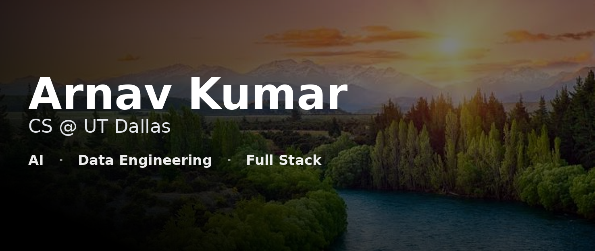

<div align="center">



<br/>

[](https://itsarnav.com)
[](https://www.linkedin.com/in/arnav-kumar2932/)
[](mailto:axk230197@utdallas.edu)

<br/>

### Data Engineering • Software Engineering • Applied AI

</div>

---

## About Me

I'm **Arnav Kumar**, a rising Junior at **UT Dallas**, currently a **Data Engineer at Resilient Inc.** Previously an AI/ML Engineering Intern at Flexon Technologies, where I helped ship an NLP-driven ETL pipeline to production.

My focus is data engineering: pipelines, orchestration, and the agentic systems that keep them healthy. I build things that hold up under real constraints: deterministic safety gates instead of "trust the LLM," bias audits instead of "assume it's fair," measured results instead of assumed ones.

10+ hackathons, 3 wins.

---

## Experience

**Data Engineer at Resilient Inc.** · *Current*

**AI/ML Engineering Intern at Flexon Technologies**
- Built and deployed an NLP-driven ETL pipeline to production, processing documents at **130/minute**, including a full run across 600 resumes.

**Project Manager at IEEE Computational Imagery, UTD**
- Coordinated project planning and cross-functional execution for the chapter's computational imaging initiatives.

**Front-End Developer at Project Management Club (PMC), UTD**
- Migrated the club site from vanilla HTML/CSS to Next.js, improving load speed by **~200ms**, verified with Google PageSpeed Insights.

---

## Research

**Attention Reallocation for LLMs** · *Fall 2025*

**Quantum Mutation Testing Assistant Researcher** · *Spring 2026*

---

## What I Build

<table>
<tr>
<td width="50%">

### Data Engineering & Governance
- Orchestrated ETL/ELT pipelines (Airflow, Dagster, dbt)
- Streaming ingestion (Kafka/Redpanda, CDC)
- Multi-agent pipeline QA, diagnosis, and remediation
- Governance, lineage, and bias/compliance auditing

</td>
<td width="50%">

### AI workflows / Agentic Systems
- Multi-agent orchestration with LangGraph
- Deterministic safety-checks gating autonomous actions
- Fine-tuning (QLoRA), inference, and ONNX/CUDA deployment
- Computer vision and geospatial ML

</td>
</tr>
<tr>
<td width="50%">

### Reliability & Observability
- Chaos engineering and blast-radius scoring
- Kubernetes-native systems
- Traces, metrics, and logs (OpenTelemetry, Prometheus, Grafana)

</td>
<td width="50%">

### Full-Stack Products
- TypeScript, React, Next.js, NestJS
- REST APIs, databases, and deployment workflows
- Clean, production-style UIs backed by real data models

</td>
</tr>
</table>

---

## Tech Stack

**Languages**
<p>
  
  
  
  
  
  
</p>

**Data Engineering & Orchestration**
<p>
  
  
  
  
  
  
  
  
  
  
  
</p>

**AI / Agentic Systems**
<p>
  
  
  
  
  
  
</p>

**Cloud, DevOps & Full-Stack**
<p>
  
  
  
  
  
  
  
  
  
  
  
  
</p>

---

## Featured Projects

### Latest Builds

<table>
<tr>
<td width="50%" valign="top">

#### [Rubiks N Solver](https://github.com/its-arnavtech/Rubiks-N-Solver)
One self-trained neural network that solves Rubik's cubes of any size, from 2×2 to 100×100+, and verifies every solution.

`Rust` `PyTorch` `WebAssembly`

</td>
<td width="50%" valign="top">

#### [Meterly](https://github.com/its-arnavtech/Meterly)
Multi-tenant usage-billing platform: tenants send usage events, watch a live dashboard, and get an accurate tiered invoice each month.

`Java` `Spring Boot` `PostgreSQL` `Kafka`

</td>
</tr>
<tr>
<td width="50%" valign="top">

#### [Pastiche](https://github.com/its-arnavtech/Pastiche)
Local audio pipeline that learns your music taste and builds new tracks from the stems of songs you already love.

`Python` `PyTorch` `FastAPI`

</td>
<td width="50%" valign="top">

#### [Jet Fuel Hedge Risk Engine](https://github.com/its-arnavtech/Jet-Fuel-Hedge-Risk-Quantification-Engine)
Measures how much fuel hedging reduces an airline's cost risk, using real fuel prices and 100,000 simulated price paths.

`Databricks` `Delta Lake` `MLflow` `Power BI`

</td>
</tr>
</table>

---

## Hackathons

- 🏆 RowdyHacks 26: Winner, Best Hardware project
- 🏆 HackSMU VII: Award winner, iMasons Infrastructure track
- 🏆 RowdyHacks: Best Use of ElevenLabs

---

## LeetCode

<div align="center">

[](https://leetcode.com/Arnav_here/)

</div>

---

## Current Areas of Interest

```txt
Data Engineering & Governance → orchestrated pipelines, agentic QA, lineage & compliance auditing
Applied AI Systems           → multi-agent systems (LangGraph) for real operational problems
Reliability Engineering      → chaos testing, observability, incident reconstruction
Computer Vision & Geospatial → geolocation, satellite imagery, segmentation
Full-Stack Products          → clean frontends backed by serious backend architecture
```
